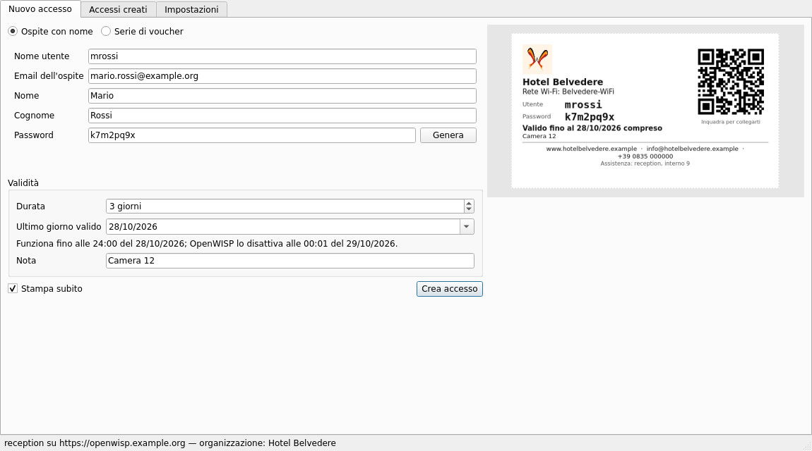
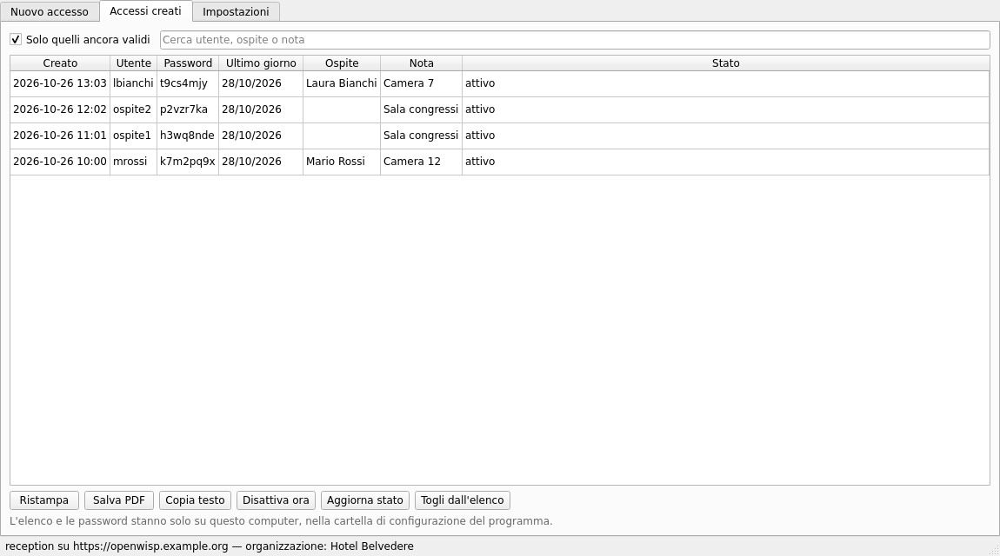
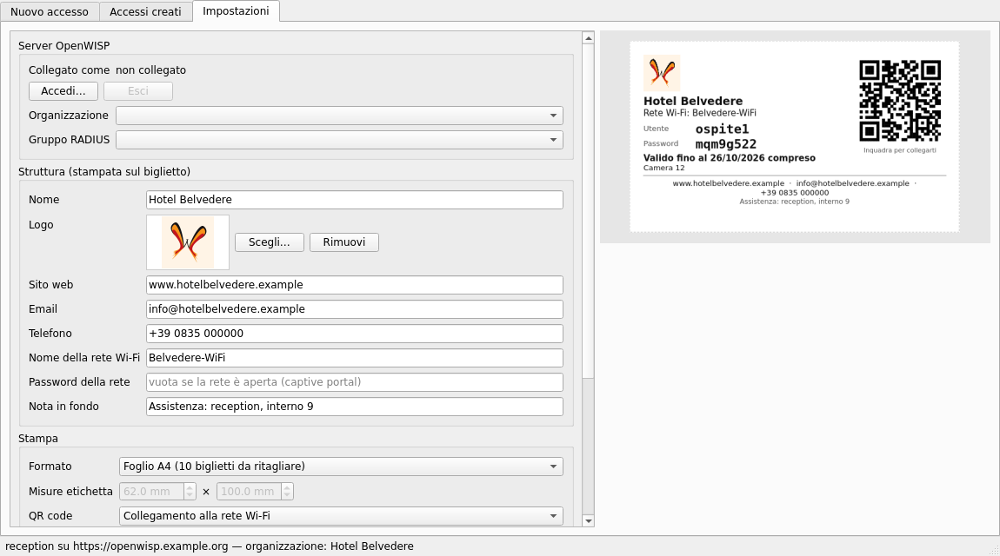
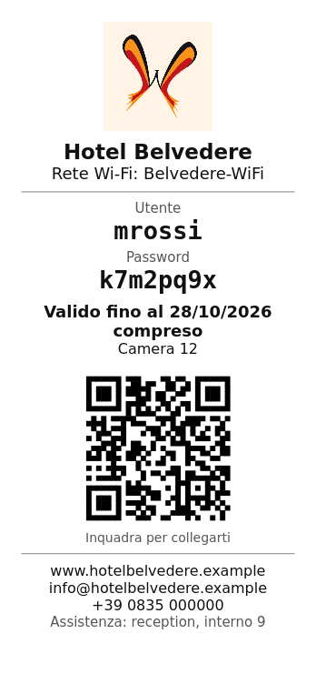

# openwisp-voucher

**English** | [Italiano](README.it.md)

Desktop program (Linux and Windows) to create **time-limited Wi-Fi accounts**
for the [OpenWISP](https://openwisp.org) captive portal and hand them out as
**tickets or labels**, like hotels do: "Mario has access for 3 days, then the
account switches off by itself".

It talks to the OpenWISP REST API with the token of the user who logs in:
nothing to install on the server.

| New access | Created accounts | Settings |
|---|---|---|
|  |  |  |

| A4 ticket | 58 mm receipt |
|---|---|
|  |  |

## Features

- **Named guest**: username (e.g. `mrossi`), guest email, name, password
  (generated without ambiguous characters such as 0/O, 1/l).
- **Voucher series**: `prefix1`, `prefix2`, … up to 200 at a time, passwords
  generated by the server.
- **Validity in days**: the ticket shows the last valid day; OpenWISP
  deactivates the account at 00:01 of the following day. Accounts can also be
  **deactivated immediately**.
- **Printing**: A4 sheet with 10 tickets to cut out, 58 or 80 mm receipt
  printers, labels of any size (Brother QL, Dymo, …), or **PDF**.
- **Customizable ticket**: logo, venue name, website, email, phone, Wi-Fi
  network name, footer note and a **QR code** that joins the Wi-Fi network (or
  opens a web address).
- **Copy text** to send the credentials by chat or email (the program never
  sends anything by itself).
- **Created accounts**: list with search, reprint, deactivate, refresh the
  status from the server.
- **Organizations**: a superuser chooses the organization; an operator works
  only on the organizations they manage.
- Italian and English interface.

## Download

From the [releases](https://github.com/mikysal78/openwisp-voucher/releases):

- **Windows**: `openwisp-voucher-<version>-windows.exe`. It is not code-signed:
  SmartScreen may ask for confirmation ("More info" → "Run anyway").
- **Linux** (x86_64): extract `openwisp-voucher-<version>-linux-x86_64.tar.gz`
  and run `./openwisp-voucher`. On Debian/Ubuntu Qt also needs
  `sudo apt install libxcb-cursor0`.

Checksums are in `SHA256SUMS`; the build provenance is attested by GitHub
(`gh attestation verify <file> -R mikysal78/openwisp-voucher`).

Or, with Python 3.10+: `pipx install git+https://github.com/mikysal78/openwisp-voucher`.

## What the OpenWISP server needs

- **openwisp-radius** (1.x) with the batch API (`/api/v1/radius/batch/`):
  accounts are created as "batch user creation" operations, visible in the admin.
- The periodic task **`deactivate_expired_users`** of openwisp-users (celery
  beat), which disables expired accounts every night. It is enabled by default
  in [ansible-openwisp2](https://github.com/openwisp/ansible-openwisp2).
- OpenWISP requires an **email** for named users: use the guest's address.
  The voucher series do not need it.

### Operator accounts

A reception operator does not need to be a superuser. In the OpenWISP admin:

1. create a user with **staff status**;
2. make them **manager** of the organization (organization users → "is admin");
3. give them, directly or through a group, these permissions:
   - `openwisp_radius | radius batch`: add, view
   - `openwisp_radius | radius group`: view
   - `openwisp_users | user`: view, change (to deactivate accounts)
   - `openwisp_users | organization`: view

In a standard installation the default OpenWISP "Administrator" group
includes them; if one is missing, the program shows "Permission denied".

## How it works

- **Login**: server address, username and password. The password is used only
  to obtain the API token and is not stored; the token goes to the system
  keyring (Windows Credential Manager, GNOME Keyring/KWallet) and, only if no
  keyring is available, to a file readable only by the user.
- **Named guest**: a one-row CSV batch with the password chosen in the program
  (`cleartext$…`), so OpenWISP sends no email. If the username is taken,
  OpenWISP adds a number (`mrossi1`): the ticket shows the real name.
- **Series**: prefix batches. Above 14 users OpenWISP works in the background
  and does not return the passwords, so longer series are split into batches of
  14.
- **Data on the computer**: settings, logo and the list of created accounts
  (with their passwords, for reprinting) are in `~/.config/openwisp-voucher`
  on Linux and `%APPDATA%\openwisp-voucher` on Windows, readable only by the
  user. "Remove from list" deletes only the local row.

## Development

```bash
python3 -m venv .venv
.venv/bin/pip install -e ".[test,build]"
.venv/bin/python -m openwisp_voucher      # start
QT_QPA_PLATFORM=offscreen .venv/bin/python -m pytest -q
PATH=$PWD/.venv/bin:$PATH packaging/build.sh   # single executable in dist/
```

### Publishing a release

1. Update `__version__` in `openwisp_voucher/__init__.py` and add a
   `## <version>` section to `CHANGELOG.md`.
2. Push a tag `v<version>`: GitHub Actions runs the tests, builds the Windows
   and Linux executables, computes `SHA256SUMS`, attests the provenance and
   publishes the release with the CHANGELOG notes.

## Related

- [openwisp-android](https://github.com/mikysal78/openwisp-android): manage
  OpenWISP from your phone.
- [How the NINUX Basilicata infrastructure is built](https://mikysal78.github.io/ninux-basilicata-infra/).

Independent project, not an official product of the OpenWISP project.

## License

[GPL-3.0](LICENSE)
